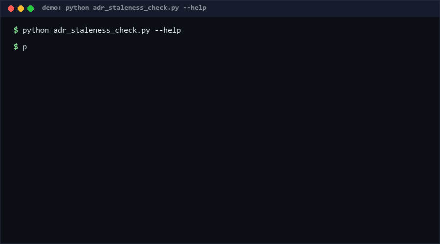

# adr-staleness-check

A drift detector for architecture decision records: it compares what your ADRs *decided* against what your implementation map says actually implements them — superseded decisions still anchoring files, accepted decisions with no evidence, broken supersedes graphs, and accepted-but-unimplemented records aging into staleness. Pure standard library, single file, offline. *Adjacent to ADR format checkers, not equivalent to them.*

<p align="center"></p>

## Problem

ADR logs rot in a specific way: the log says "we chose Postgres" (ADR-0001), then ADR-0007 quietly moves to SQLite — but the migration checklist still cites ADR-0001, the schema files still live under a folder named for it, and nobody re-reads a record marked *Superseded* two years ago. Format checkers validate that each record is well-formed; nothing validates that the *decisions* still describe the *system*.

## How it works

Two inputs:

- an **ADR directory** — `NNNN-title.md` markdown files; the parser extracts status (Accepted / Proposed / Superseded / Rejected / Deprecated), `Superseded by ADR-NNNN` / `Supersedes ADR-NNNN` references, and the first ISO date;
- an **implementation map** — JSON: `{"ADR-0001": ["db/schema.sql"], "ADR-0002": ["migrator/"]}`, paths resolved against `--impl-root` (default: the ADR dir).

Checks (exit 1 on any error):

| Rule | Sev | Meaning |
|---|---|---|
| M1 | error | map references an ADR that does not exist |
| M2 | error | anchored path missing on disk |
| M3 | error | Superseded ADR still anchored in the map (the core drift signal) |
| M4 | warning | Accepted ADR with zero anchors |
| G1 | error | cycle in the supersedes graph |
| G2 | warning | superseded by a non-later number (violates sequential-monotonic numbering) |
| G3 | error | one ADR number used by several files |
| G4 | error | superseded-by target missing |
| S1 | warning | Accepted ADR older than `--stale-days` (default 365) whose every anchor is missing |

## How this differs from adr-health-check

[adr-health-check](https://github.com/INNERLUXES/adr-health-check) is a format health checker for ADR folders. Its README states: *"It reads every record, finds its layout, its title, its status and its links, and reports what keeps the decision log from being read"* — missing sections, placeholders, unknown statuses, numbering gaps, and links to files that are not there. That layer is intra-record: is each document well-formed and cross-referenced correctly. This repo operates one layer out: given well-formed records, is the **decision set still consistent with the implementation map** — a superseded decision whose files are still anchored (M3), accepted decisions with no implementation evidence (M4), and supersedes-graph integrity (G1/G2/G4). The two tools compose: run a format check first, then this for drift.

## Quickstart

```console
$ python adr_staleness_check.py check docs/adrs impl-map.json --impl-root .   # ~0.2 s
scanned 12 ADR(s), 2 finding(s)
error   M3 [0001-pg.md] ADR-0001 is Superseded but the impl map still anchors 3 file(s) to it
warning M4 [0004-sso.md] ADR-0004 is Accepted with no implementation anchor
```

Parsing 200 synthetic ADRs takes 0.12 s [Measured] (see Performance).

## Why not X

- **adr-health-check** (the anchor above) — same input folder, different layer: format and cross-reference health, not decision-vs-implementation drift; it does not read an implementation map at all.
- **adr-tools / MADR templates** — help you *write* records; they carry no state after the commit and cannot tell you a decision went stale.
- **Architecture conformance tools (jMolecules, ArchUnit, dependency-cruiser)** — enforce code-level rules against declared architecture; they do not consume ADR text or detect supersession drift, and require per-language integration.
- **Manual ADR reviews** — the status quo: a quarterly ritual that reads titles, not anchor consistency, and scales poorly past ~50 records.

## Performance

All numbers [Measured] locally (Python 3.13, Windows 10, single core):

| Workload | Result | Command |
|---|---|---|
| 200 synthetic ADRs parsed | 0.12 s (~1.6k rec/s) | `python adr_staleness_check.py bench --records 200` |
| 100 ADRs + 100 anchors checked | <0.1 s | `python adr_staleness_check.py check docs/adrs map.json` |

`bench` builds a deterministic synthetic folder and times only parsing.

## Minimal Fallback

Without this tool: add one line to every ADR — `Implements: path/to/thing` — and grep both directions monthly: `grep -L "Implements:" adr/*.md` for unanchored decisions, and a script that checks each mentioned path still exists. You lose supersession drift detection (M3) and cycle checks, but the grep pair alone catches most silent rot.

## Design Trade-offs

- **An explicit map, not code inference.** Inferring "what implements ADR-0001" from commit messages or imports is language-bound and wrong often; a reviewed JSON map is boring and auditable.
- **Markdown regex, not a MADR/Nygard parser.** We read five fields, not the layout; format correctness is deliberately delegated to format checkers.
- **Date-based staleness with an overridable `--today`** — reproducible in tests and CI, at the cost of ignoring the system clock by default.
- **Warnings for orphans (M4), errors for drift (M3)** — bootstrapping a map on a legacy ADR set should not fail CI; contradicting a superseded decision should.

## Limits & Second-order Effects

- The map is a second artifact that can itself rot; treat changes to it with the same review as the ADRs it mirrors.
- Anchored paths say files exist, not that behavior matches the decision — M2-clean does not mean implemented, only that evidence is pointed at.
- Teams may add anchors mechanically to silence M4, recreating drift inside the map; watch for map edits bundled with unrelated changes.
- Numbering-monotonicity checks (G2) assume sequential ADR numbering; orgs that reuse numbers or branch their logs will see false warnings.

## FAQ

**When NOT to use this?** If your ADR log is under ~10 records and actively maintained by one team, a format checker plus review is enough. Also skip it if decisions in your org are recorded anywhere but files (issue trackers, wikis) — the parser only sees markdown.

**Is this a replacement for adr-health-check?** No — complementary. It checks that each record is healthy; this checks that the record *set* still describes the implementation. Run both.

**Why is M3 an error and M4 only a warning?** Anchoring files to a superseded decision actively contradicts the log; an unanchored accepted decision is merely unfinished evidence.

**Does it ever modify my files?** No — it reads the ADR dir and map and writes nothing.

## [Core Assumptions]

1. ADRs are individual markdown files named `NNNN-title.*`; wiki-page ADR logs are out of scope.
2. Supersession is declared in text (`Superseded by ADR-NNNN`); implicit supersession (silence) cannot be detected by any static tool.
3. An implementation map maintained by humans stays more honest than inferred anchors, even though it can rot.
4. Sequential, monotonic ADR numbering (the Nygard convention) holds for the org adopting this.

Confidence: High (≥80%) for the drift rules M1–M4 and graph checks (directly testable mechanics); Medium (60-79%) for date-based staleness usefulness and the map-rot mitigation. As of 2026-10-13.

---

Part of the [zhengming-toolbox](https://github.com/chenhz01/zhengming-toolbox) — 105 purpose-built AI-engineering tools across neglected niches.

Related tools: [agent-stop-condition-spec](https://github.com/chenhz01/agent-stop-condition-spec) · [agent-loop-detector](https://github.com/chenhz01/agent-loop-detector) · [agent-permission-audit](https://github.com/chenhz01/agent-permission-audit)
